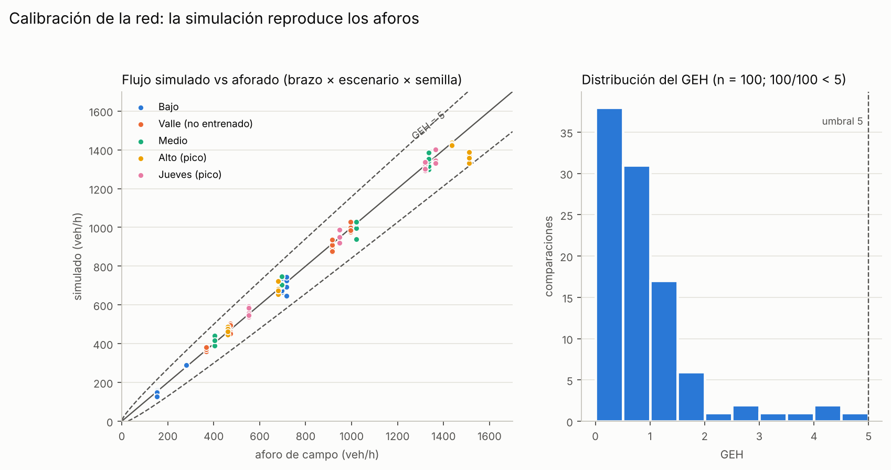
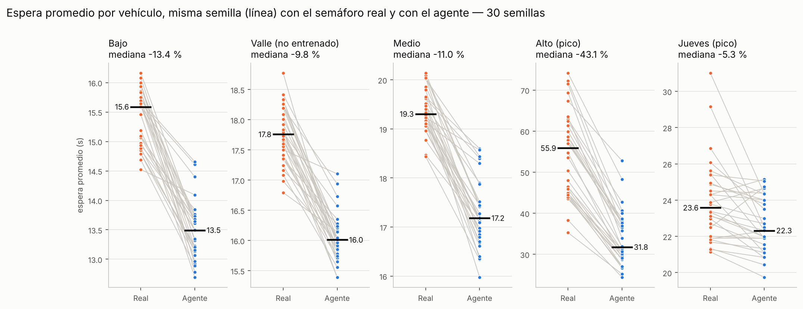
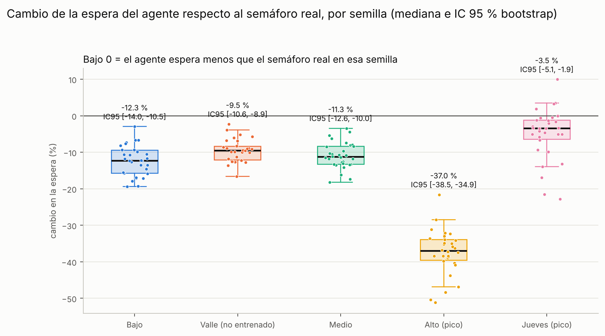
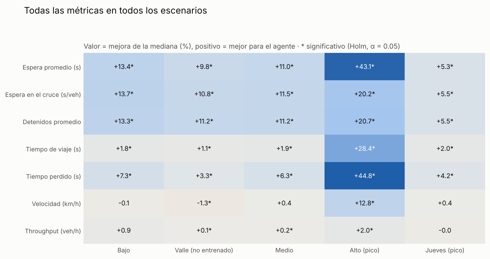
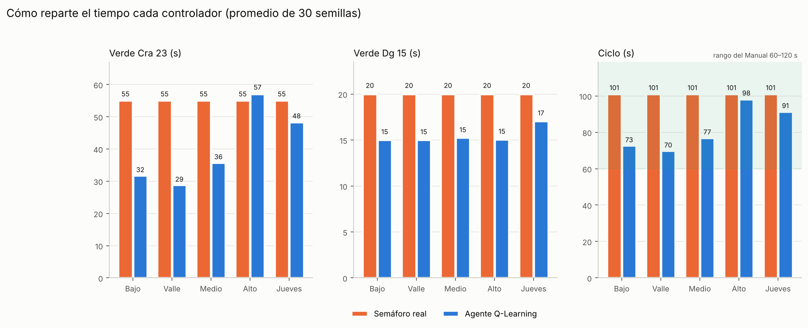
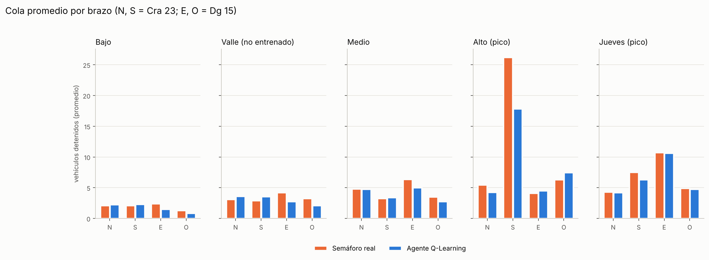
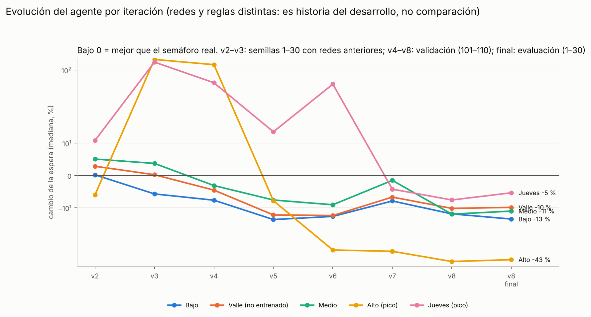
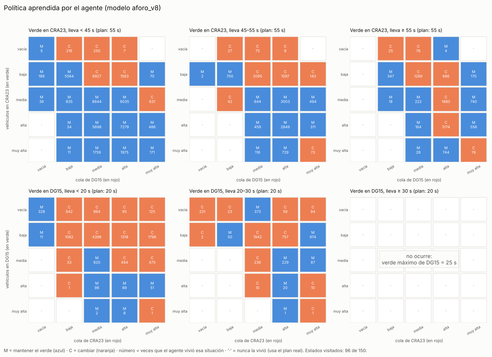

# Figuras de la tesis: qué muestra cada una

Estas figuras resumen la **parte simulada** del proyecto: un semáforo inteligente (agente de *Machine Learning* por
refuerzo, Q-Learning) comparado con el **semáforo real** de la intersección **Carrera 23 × Diagonal 15 (Acacías, Meta)**.

Todas se generan con `scripts/graficas_tesis.py` a partir de resultados guardados en `results/` (no se inventa ni se
estima ningún dato). La estadística completa está en [`estadistica_evaluacion_final.md`](estadistica_evaluacion_final.md).

**Conceptos que se repiten:**

- **Escenario:** una hora de tráfico real contada en campo (aforo). Hay cinco: *bajo*, *valle*, *medio*, *alto* (hora
  pico) y *jueves* (hora pico grabada en video en los cuatro brazos a la vez). El agente **nunca vio el escenario valle**
  durante su entrenamiento: sirve para comprobar que aprendió algo general y no memorizó.
- **Semilla:** el mismo tráfico medido puede llegar de muchas formas (quién llega primero, a qué segundo, qué tipo de
  vehículo). Cada semilla es una de esas formas. Para cada semilla se simula **la misma hora dos veces**, una con el
  semáforo real y otra con el agente: así la comparación es justa (mismo tráfico, distinto semáforo).
- **Evaluación final:** 30 semillas por escenario (1–30), que **no se usaron** para diseñar ni ajustar el agente.
  5 escenarios × 30 semillas × 2 semáforos = 300 horas simuladas.
- **Semáforo real:** el plan medido en campo: 55 s de verde para la Cra 23, 20 s para la Dg 15, ciclo de 101 s, igual
  a toda hora.
- **Espera promedio:** segundos que, en promedio, cada vehículo pasa detenido. Es la métrica principal: **menos es mejor**.

---

## Figura 1. Calibración: ¿la simulación se parece a la realidad?

**Qué muestra.** A la izquierda, cada punto compara los vehículos por hora **contados en campo** (eje horizontal) con los
que pasaron en la **simulación** (eje vertical), para cada brazo, escenario y semilla. Si la simulación fuera perfecta,
todos los puntos estarían sobre la línea diagonal. Las líneas punteadas marcan el límite **GEH = 5**, un criterio usado en
ingeniería de tránsito para decidir si un modelo reproduce bien un conteo. A la derecha, cuántas comparaciones tienen
cada valor de GEH.

**Qué logra.** Las **100 comparaciones** quedan dentro del límite (GEH < 5; promedio 0.89). Es decir, la intersección
simulada mueve la misma cantidad de vehículos que la real. Sin esto, cualquier resultado posterior no tendría valor.

---

## Figura 2. Resultado principal: espera con el semáforo real y con el agente

**Qué muestra.** Un panel por escenario. Cada punto naranja es una semilla con el semáforo real; cada punto azul es **la
misma semilla** con el agente. La línea gris une las dos versiones de la misma hora. La raya negra es la mediana (el valor
del medio).

**Cómo leerla.** Si la línea gris **baja** de izquierda a derecha, el agente hizo esperar menos que el semáforo real en esa
hora.

**Qué logra.** En bajo, valle, medio y alto **todas** las líneas bajan (30 de 30). En la hora pico *alto* la espera baja
de **55.9 s a 31.8 s** (−43 %). En el *jueves*, la mejora es pequeña (−5 %) y se da en 26 de 30 semillas.

---

## Figura 3. ¿Cuánto mejora en cada hora simulada?

**Qué muestra.** Para cada semilla, el **porcentaje de cambio** de la espera del agente respecto al semáforo real. Cada
punto es una semilla; la caja reúne la mitad central de los valores; la raya negra es la mediana. Encima, la mediana y su
**intervalo de confianza del 95 %** (IC 95 %), calculado por remuestreo (*bootstrap*).

**Cómo leerla.** Por debajo de la línea 0, el agente es mejor. El IC 95 % indica el rango donde, con alta confianza, está
el efecto verdadero.

**Qué logra.** Los cinco intervalos están **completamente por debajo de cero**: la mejora no es casualidad. En alto, la
mediana es −37 % con IC 95 % entre −38.5 % y −34.9 %.

---

## Figura 4. Todas las métricas en todos los escenarios

**Qué muestra.** Siete medidas de desempeño (filas) en los cinco escenarios (columnas). Cada número es la **mejora** de la
mediana en porcentaje; **positivo = mejor para el agente** (por ejemplo, menos espera o más velocidad). Azul = mejora,
naranja = empeora, gris = sin cambio. El asterisco (*) indica que la diferencia es **estadísticamente significativa**
(prueba de Wilcoxon con corrección de Holm, α = 0.05).

**Qué logra.** El agente mejora la espera, la cola y el tiempo de viaje en **los cinco escenarios**, todo significativo.
En la hora pico *alto* el efecto es grande: tiempo perdido −45 %, viaje −28 %, velocidad +13 % y **2 % más vehículos por
hora**. El flujo (*throughput*) nunca empeora de forma significativa: la mejora **no** viene de dejar vehículos por fuera.

---

## Figura 5. Cómo reparte el tiempo cada semáforo

**Qué muestra.** Promedio de 30 semillas del verde de la Cra 23, el verde de la Dg 15 y la duración del ciclo (una vuelta
completa de luces). La franja verde del último panel es el rango de ciclo recomendado por el **Manual de Señalización
Vial 2024** (60–120 s).

**Qué logra (qué aprendió el agente).** El semáforo real usa siempre 55/20 s y 101 s de ciclo. El agente **se adapta**:
con poco tráfico hace ciclos cortos (70–77 s) para que nadie espere de más; en la hora pico *alto* le da casi todo el
verde a la Cra 23 (57 s), la vía que más vehículos lleva; en el *jueves*, donde la Dg 15 está más cargada, le da algo más
de verde. Sus ciclos quedan dentro del rango del Manual (61–121 s; más de 120 s solo en pocos ciclos de pico).

---

## Figura 6. Colas en cada brazo

**Qué muestra.** Vehículos detenidos en promedio en cada brazo de la intersección: N y S (Carrera 23), E y O (Diagonal 15).

**Qué logra.** En la hora pico *alto*, la cola del sur (el brazo más cargado, hacia Villavicencio) baja de **26 a 17
vehículos**. El agente no "esconde" la espera en otro brazo: las demás colas se mantienen parecidas. En tráfico bajo y
medio reduce sobre todo la cola de la Dg 15 este.

---

## Figura 7. Cómo evolucionó el agente durante el desarrollo

**Qué muestra.** El cambio de la espera frente al semáforo real en cada versión del agente (v2 a v8) y en la evaluación
final. Escala comprimida para ver a la vez fallos grandes y mejoras pequeñas.

**Importante.** No es una comparación entre versiones: cada una se probó con la red y las reglas que había en ese
momento. Es la **historia del desarrollo**.

**Qué logra.** Muestra el proceso real: las primeras versiones empeoraban mucho en hora pico (más de +100 %). Cada fallo
se diagnosticó con datos y se corrigió (recompensa que el agente "engañaba", bloqueos del simulador, sesgo al decidir
cuándo cambiar, estados poco informativos). Desde v5 el agente mejora en tráfico normal, y desde v8 en todos los
escenarios. El detalle está en `docs/bitacora.md`.

---

## Figura 8. Qué decide el agente (política aprendida)

**Qué muestra.** El "cerebro" del agente es una tabla: para cada situación del tráfico dice si **mantener** el verde (M,
azul) o **cambiar** (C, naranja). Cada panel corresponde a una vía en verde y a cuánto tiempo lleva en verde. En cada
cuadro, la fila es cuántos vehículos hay en la vía en verde y la columna, cuántos esperan en la vía en rojo. El número es
cuántas veces el agente vivió esa situación al entrenar; "·" = nunca la vivió (en ese caso usa el plan del semáforo real).

**Cómo leerla (ejemplos).** Cra 23 en verde con pocos vehículos (*baja*) y la Dg 15 con cola *media* → **cambiar**: no
tiene sentido mantener el verde a una vía casi vacía. Cra 23 con cola *media* o *alta* → **mantener** aunque la Dg 15
espere: hay más vehículos que atender en la vía principal.

**Qué logra.** Permite **explicar** las decisiones del agente (no es una caja negra). El agente visitó 96 de los 150
estados posibles; el último panel queda vacío porque la Dg 15 nunca puede pasar de 25 s de verde (regla de seguridad).

---

## Figuras 10 y 11. Dinámica de una hora simulada (si existen)

`fig10_dinamica_aforo_bajo.png` y `fig11_dinamica_aforo_alto.png` muestran, para la semilla 1, los vehículos detenidos
minuto a minuto con cada semáforo (arriba) y la secuencia de luces entre los minutos 30 y 40 (abajo). Se ve cómo el
semáforo real repite siempre el mismo patrón y el agente alarga o acorta los verdes según el tráfico. Para generarlas, ver
la ayuda de `scripts/graficas_tesis.py`.

---

## Límites de estos resultados

- Son resultados de **simulación** (SUMO) calibrada con datos de campo, no una prueba en la calle.
- Se excluyó el semáforo de la Calle 18 (≈ 260 m al norte), porque producía bloqueos artificiales en el simulador.
- El aforo *alto* no fue simultáneo en los cuatro brazos; el brazo sur simulado lleva algo menos que el contado (1361 vs
  1512 vehículos/hora).
- El agente usa los mismos tiempos de amarillo y despeje que el semáforo real.
- El diseño del agente pasó por 7 iteraciones probadas con semillas de validación (101–110); la evaluación final con las
  semillas 1–30 se corrió **una sola vez**.
